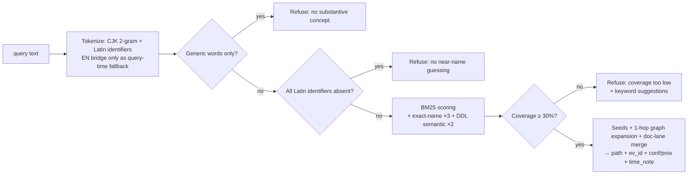

# domimap — Local-first Knowledge Retrieval Engine

**Domain + Map**: turn multiple Java repositories, project docs, and human knowledge into one queryable, evidence-cited domain map.

**English** | [简体中文](README.zh-CN.md)

[](https://github.com/SunArthurX/domimap/actions/workflows/ci.yml) [](https://github.com/SunArthurX/domimap/blob/main/pyproject.toml) [](https://github.com/SunArthurX/domimap/blob/main/pyproject.toml) [](https://github.com/SunArthurX/domimap/blob/main/LICENSE)

## What is domimap?

domimap is a local-first knowledge retrieval engine that builds a queryable domain map from multiple Java repositories, project documentation, and human-curated knowledge. It offers CLI, MCP (Model Context Protocol) server, and Web UI interfaces — so both humans and AI agents can search, trace, and **cite evidence** across an entire codebase. Building the graph is deterministic and **LLM-free**; language models only ever appear as optional, clearly-labelled enhancement layers.

## Key Features

| Feature | Description |
|---|---|
| **Multi-repo aggregation** | Index many repos into one unified graph |
| **Hybrid retrieval** | BM25 lexical + graph expansion + domain seeds (+ optional local embeddings) |
| **Evidence citation** | Every result carries a file path + immutable evidence ID |
| **Immutable evidence** | Source edits/deletions never break old citations |
| **Knowledge timeline** | Content-era extraction (explicit dates/versions, not file mtime) |
| **Honest refusal** | Four refusal gates — no near-name guessing, no hallucinated hits |
| **MCP integration** | Native MCP stdio server (6 `kg_*` tools) for AI clients |
| **Zero core dependencies** | Pure Python stdlib; optional deps only enhance |

## Quick Start

```bash
git clone https://github.com/SunArthurX/domimap.git && cd domimap

# No install needed — pure stdlib
# Single repo: --merge puts the graph directly in out/idx
python3 -m domimap build ~/my-java-projects -o out/idx --merge

# Multi-repo workspace (recommended): auto-discover sub-repos → merged graph
# + evidence store + incremental manifest
python3 -m domimap build ~/work/my-workspace --discover -o out/idx
python3 -m domimap update -o out/idx   # incremental; ms-level no-op if unchanged

# Or install as a CLI
pip install .            # provides the `domimap` command

# Optional PDF/DOCX ingestion
pip install pypdf python-docx
```

### CLI

```bash
# Build & update
python3 -m domimap build ~/work/my-workspace --discover -o out/idx  # merged graph + evidence store
python3 -m domimap build ~/repo-a -o out/idx --merge                # single repo
python3 -m domimap update -o out/idx                                # incremental

# Search (Chinese & English)
python3 -m domimap query "订单改价 changePrice" -g out/idx/graph.json
python3 -m domimap query "ai_resource 表 定义 写入" -g out/idx/graph.json

# Read evidence by ID (immutable — survives source changes)
python3 -m domimap read <evidence_id> --store out/idx/store.db

# Domain map / impact / scenario cards
python3 -m domimap domain -g out/idx/graph.json
python3 -m domimap impact "OrderService" -g out/idx/graph.json
python3 -m domimap scenario req "订单改价 需要防并发" -g out/idx/graph.json

# Machine-readable graph schema (feed it to your AI client)
python3 -m domimap schema

# Web UI (loopback only)
python3 -m domimap ui -g out/idx/graph.json --port 8080
```

### Optional LLM enrichment (post-build, off by default)

One command sends Doc materials to a **configurable** LLM (Anthropic-compatible API, default GLM-5.3) and files the results as **inference drafts — never facts**:

```bash
python3 -m domimap enrich -g out/idx/graph.json --limit 5            # docs (default, incremental)
python3 -m domimap enrich -g out/idx/graph.json --targets domain     # per-domain materials
python3 -m domimap enrich -g out/idx/graph.json --dry-run            # preview, no network
python3 -m domimap enrich -g out/idx/graph.json --json --budget-tokens 200000
```

- **Config** (flag > env > default): `DOMIMAP_LLM_ENDPOINT`, `DOMIMAP_LLM_MODEL` (glm-5.3), `DOMIMAP_LLM_MAX_TOKENS` (1024), `DOMIMAP_LLM_TIMEOUT` (120s); key from `GLM_API_KEY` / `ANTHROPIC_API_KEY` / `DOMIMAP_LLM_KEY_HELPER` (missing key or busy lock → exit code 6, never a silent downgrade).
- **Discipline**: drafts go into `knowledge.db` beside the graph with `conf=LLM, prov=knowledge:llm` and claims `inference/proposed`; only human `accept` makes them confirmed knowledge. `evidence_paths` are server-side whitelist-validated (fabricated paths dropped + audited). Idempotent re-runs (zero calls, zero new notes on unchanged graph); superseded docs auto-withdraw old LLM notes; every call is journaled to `enrichment.jsonl` (crash-safe, no double billing).
- **Hardening**: 4xx fails that item without retry; 429/5xx honor `Retry-After` with jittered backoff; `--budget-tokens` stops cleanly; per-directory mutex (`.enrich.lock`); materials wrapped in delimiters and declared "data, not instructions" (prompt-injection mitigation); `--json` prints per-item detail and cost estimate.
- **Threat model**: the key lives only in process memory; endpoint is yours to choose — data will be sent there; human review is the final gate against adversarial content.

### Optional query-time layers (all off by default; offline core semantics unchanged)

- **Semantic bridge** (`DOMIMAP_SEMANTIC_BRIDGE=1` or `query --semantic`): when raw coverage < 60% and the query contains Chinese, the same configurable LLM generates English keywords, which are grounded against the index vocabulary before merging into the candidate union; any failure skips cleanly and refusal semantics stay byte-identical.
- **LLM rerank** (`DOMIMAP_LLM_RERANK=1` or `query --rerank`): re-orders the top-N fused candidates via the LLM (opaque ids only — zero injection surface). Measured zero effect on our corpora; kept as an isolated, contract-tested option.
- **Embedding fusion** (`domimap embed` to build the index, then `--embed`/`DOMIMAP_EMBED=1`): local **bge-small-zh-v1.5** via `pip install fastembed` (offline, free; or `DOMIMAP_EMBED_BACKEND=api` for bigmodel embedding-3), fused with the lexical order via RRF (K=60). A **fusion eligibility gate** keeps lexical authority for definition-identifier / code-location queries. Real A/B on both corpora: pub 23/97→36/97, dev 19/36→26/36, zero regressions, negatives unchanged.

## MCP Server

```bash
python3 -m domimap serve -g out/idx/graph.json
```

Connect **Claude Code / ZCode / Codex / DSH** (per-client setup in [docs/clients.md](docs/clients.md)):

```json
{
  "mcpServers": {
    "domimap": {
      "command": "python3",
      "args": ["-m", "domimap", "serve", "-g", "/path/to/out/idx/graph.json"]
    }
  }
}
```

| Tool | Description |
|---|---|
| `kg_explore` | Main search: lexical seeds + graph expansion, returns services/classes/methods/routes/tables/docs with confidence and provenance |
| `kg_read` | Read evidence by ID (immutable — survives source changes) |
| `kg_domain_map` | Domain map: domain → services/tables/topics/docs |
| `kg_impact` | Impact analysis: reverse dependencies of a symbol |
| `kg_doc_search` | Full-text document search |
| `kg_troubleshoot` | Symptom → graph+docs dual recall → ranked suspects |

**Recommended agent loop**: `kg_domain_map` for the big picture → `kg_explore` to search → `kg_read(ev_id)` for the immutable source → cite **path + ev_id**; on `refused=true`, say so instead of guessing.

### Web UI

```bash
python3 -m domimap ui -g out/idx/graph.json --port 8080   # loopback only, zero deps
```


### Machine-readable schema

`domimap schema` outputs the full node/edge taxonomy, confidence & provenance semantics, tool list and refusal gates as JSON. A contract test keeps it in sync with the implementation (zero drift). Human reference: [docs/knowledge-graph.md](docs/knowledge-graph.md).

## Architecture

```mermaid
flowchart TB
    subgraph SRC["Workspace: code & docs"]
        REPOS["Java repos · MyBatis XML · SQL DDL"]
        DOCS["Markdown · HTML · PDF* · DOCX* · TS/JS/Vue"]
    end
    subgraph BUILD["Build — deterministic, no LLM"]
        SCAN["Scanners (lite_scan)<br/>GBK/GB18030 auto-detect"]
        CHUNK["Doc chunking<br/>long docs → overlapping segments"]
        GRAPH["Knowledge Graph<br/>12 node kinds · 13 edge kinds<br/>conf: EXTRACTED / INFERRED / AMBIGUOUS"]
        STORE["Evidence Store (SQLite)<br/>ev_id · content-addressed<br/>immutable generations"]
        SCAN --> CHUNK --> GRAPH
        SCAN --> STORE
    end
    subgraph ENGINE["Search Engine (search.py)"]
        BM25["BM25 k=1.2 b=0.75<br/>identifier ×3 · DDL semantic ×2"]
        EMB["Semantic lane (optional)<br/>local embeddings · RRF fusion<br/>+ eligibility gate"]
        EXPAND["Graph expansion<br/>CALLS · READS/WRITES · MQ edges"]
        LANE["Doc lane merge<br/>+ content-era time notes"]
        GUARD["4 honest-refusal gates"]
    end
    KBX["Knowledge Base (SQLite)<br/>human notes · claims · review workflow"]
    ENR["`domimap enrich` (optional post-build)<br/>LLM draft notes · conf=LLM<br/>human review before facts"]
    CLI["CLI"]
    MCP["MCP stdio server<br/>6 kg_* tools"]
    UI["Web UI (loopback)"]
    REPOS --> SCAN
    DOCS --> SCAN
    GRAPH --> BM25
    GRAPH -.optional.-> EMB
    STORE --> LANE
    KBX -.attach.-> BM25
    ENR -.drafts.-> KBX
    BM25 --> EXPAND --> LANE --> GUARD
    EMB --> LANE
    GUARD --> CLI
    GUARD --> MCP
    GUARD --> UI
```

\* = optional dependency required (`pip install pypdf python-docx`)

### Query data flow



Evolution & maturity plan: [docs/evolution.md](docs/evolution.md) · Full schema reference: [docs/knowledge-graph.md](docs/knowledge-graph.md)

## Benchmark Results

Five systems — domimap and four open-source competitors ([Codebase-Memory-MCP](https://github.com/DeusData/codebase-memory-mcp), [claude-obsidian](https://github.com/AgriciDaniel/claude-obsidian), [Graphify](https://github.com/Graphify-Labs/graphify), [CodeGraph](https://github.com/colbymchenry/codegraph)) — were driven by the **same host model (GLM-5.3), the same system prompt, the same turn/tool budget, and a per-system copy of the same workspace**. Scoring is mechanical answer-layer citation matching (bidirectional path match). All numbers are **same-session developer evaluations, not the frozen independent confirmation run** required by [specs/benchmark.md](specs/benchmark.md); the release gate (`make release-check`) therefore stays closed.

### Dev set — enterprise Java corpus (33 questions)

27 scored positives (code 8 · cross-repo 8 · doc 5 · fresh 6) + 4 negatives + 2 locator-diagnostic.

| System | code | cross-repo | doc | fresh | **Positives** | Negatives (abstain) | Locator |
|---|---|---|---|---|---|---|---|
| **domimap** | **8/8** | **8/8** | **4/5** | **4/6** | **24/27 (89%)** | 4/4 | 2/2 |
| Codebase-Memory-MCP | 0/8 | 8/8 | 0/5 | 1/6 | 9/27 (33%) | 4/4 | 0/2 |
| CodeGraph | 3/8 | 0/8 | 0/5 | 0/6 | 3/27 (11%) | 4/4 | 0/2 |
| Graphify | 2/8 | 0/8 | 0/5 | 0/6 | 2/27 (7%) | 4/4 | 1/2 |
| claude-obsidian | 0/8 | 0/8 | 0/5 | 1/6 | 1/27 (4%) | 4/4 | 1/2 |

### Public corpus — 27 unseen open-source families (40 questions)

32 scored positives (8 per category) + 4 negatives + 4 locator-diagnostic.

| System | code | cross-repo | doc | fresh | **Positives** | Negatives (abstain) | Locator |
|---|---|---|---|---|---|---|---|
| **domimap** | **6/8** | **8/8** | 4/8 | **4/8** | **22/32 (69%)** | 4/4 | 1/4 |
| Codebase-Memory-MCP | 5/8 | 8/8 | 3/8 | 1/8 | 17/32 (53%) | 4/4 | 2/4 |
| claude-obsidian | 5/8 | 3/8 | 4/8 | 1/8 | 13/32 (41%) | 4/4 | 3/4 |
| Graphify | 3/8 | 0/8 | **5/8** | 3/8 | 11/32 (34%) | 4/4 | 3/4 |
| CodeGraph | 2/8 | 3/8 | 0/8 | 0/8 | 5/32 (16%) | 4/4 | 0/4 |

Paired differences on the public corpus (n = 36 = 32 positives + 4 negatives):

| Comparison | domimap | Competitor | Difference |
|---|---|---|---|
| vs Codebase-Memory-MCP | 26/36 | 21/36 | +13.9 pp |
| vs claude-obsidian | 26/36 | 17/36 | +25.0 pp |
| vs Graphify | 26/36 | 15/36 | +30.6 pp |
| vs CodeGraph | 26/36 | 9/36 | +47.2 pp |

All four paired differences are positive on both corpora, but the gaps narrow sharply on the English-heavy public corpus: Graphify leads on document reasoning there, and three competitors beat domimap on the locator-diagnostic subset. These results are scoped to these two corpora and this host and are not a claim of general superiority. Raw artifacts, runners and the frozen protocol live under [`benchmarks/`](benchmarks/README.md).

### Performance

| Metric | Value |
|---|---|
| Index build (9 repos, 37K files) | 14 minutes |
| Query latency (single query) | < 1 second |
| Full 33-question evaluation | 1.2 seconds (diagnostic track) |
| Memory (peak RSS, 9-repo index) | ~4.3 GB |

## Supported Formats

| Format | Status | Notes |
|---|---|---|
| Java (.java) | ✅ Full | GBK/UTF-8 auto-detect, comments indexed |
| MyBatis XML (.xml) | ✅ Full | Mapper namespace, SQL statements, table extraction |
| SQL DDL (.sql) | ✅ Full | CREATE TABLE parsing, DDL semantic boost |
| Markdown (.md) | ✅ Full | Front-matter (valid_until/superseded_by) |
| HTML (.html) | ✅ Full | Tag stripping, entity decoding |
| Plain text (.txt) | ✅ Full | GBK fallback |
| PDF (.pdf) | ⚠️ Optional | Requires `pypdf` |
| DOCX (.docx) | ⚠️ Optional | Requires `python-docx` |
| TypeScript/JavaScript | ✅ Basic | Frontend framework detection |
| Vue (.vue) | ✅ Basic | Component scanning |

## Development

```bash
make ci              # what CI runs: structural spec check + full test suite
make verify          # local gate: additionally verifies evidence fingerprints in out/verification
make release-check   # release gate — fails by design until the frozen confirmation run exists
make mini            # build a mini test graph and try a query
```

Optional parsers for the PDF/DOCX ingestion contracts: `pip install pypdf python-docx` (those tests skip when absent).

### Project Structure

```
domimap/
├── domimap/           # Core Python package (zero deps)
│   ├── lite_scan.py   # Multi-format scanner (Java/MyBatis/DDL/MQ/docs)
│   ├── chunking.py    # Long-doc segmentation (BM25 + embedding dual-end)
│   ├── graph.py       # Knowledge-graph builder
│   ├── search.py      # BM25 + graph search + refusal gates
│   ├── embedding.py   # Optional local embedding index (RRF fusion)
│   ├── llm_enrich.py  # Optional LLM draft notes (conf=LLM, human-reviewed)
│   ├── mcp.py         # MCP stdio server (7 read-only tools incl. kg_context; kg_feedback behind --enable-write; hot reload)
│   ├── store.py       # Evidence store (immutable generations)
│   ├── knowledge.py   # Knowledge base (notes/claims/review)
│   └── ...
├── benchmarks/        # Five-system comparison suite + frozen protocol
├── tests/             # Contract tests (every feature has negative cases)
├── specs/             # Requirements, acceptance cases, task manifests
└── docs/              # Documentation
```

## Documentation

| Document | Description |
|---|---|
| [docs/README.md](docs/README.md) | Documentation index |
| [docs/knowledge-graph.md](docs/knowledge-graph.md) | **Knowledge-graph model reference** — node/edge taxonomy, evidence store, time model, query flow |
| [docs/evolution.md](docs/evolution.md) | **Maturity gaps & evolution plan** |
| [docs/roadmap.md](docs/roadmap.md) | Production roadmap |
| [docs/architecture.md](docs/architecture.md) | Architecture details |
| [docs/clients.md](docs/clients.md) | MCP client integration guide |
| [specs/benchmark.md](specs/benchmark.md) | Benchmark protocol |

## Known Limitations

- **Evaluation status**: all benchmark numbers are same-session developer evaluations; the frozen independent confirmation run has not been executed and `make release-check` fails by design until it is
- **Cross-lingual gap (mostly closed)**: pure-BM25 could not match Chinese queries to English content; the optional embedding lane + doc chunking lifted public-corpus retrieval from 50→70/140 — answer-layer reruns still pending
- **Same-name methods**: methods with identical names in different classes share a node (service-level naming)
- **Source updates**: incremental updates are manual (`domimap update`; no file watcher yet)
- **Platform**: fully tested on macOS + Linux CI; Windows untested

## License

MIT License. See [LICENSE](LICENSE).
