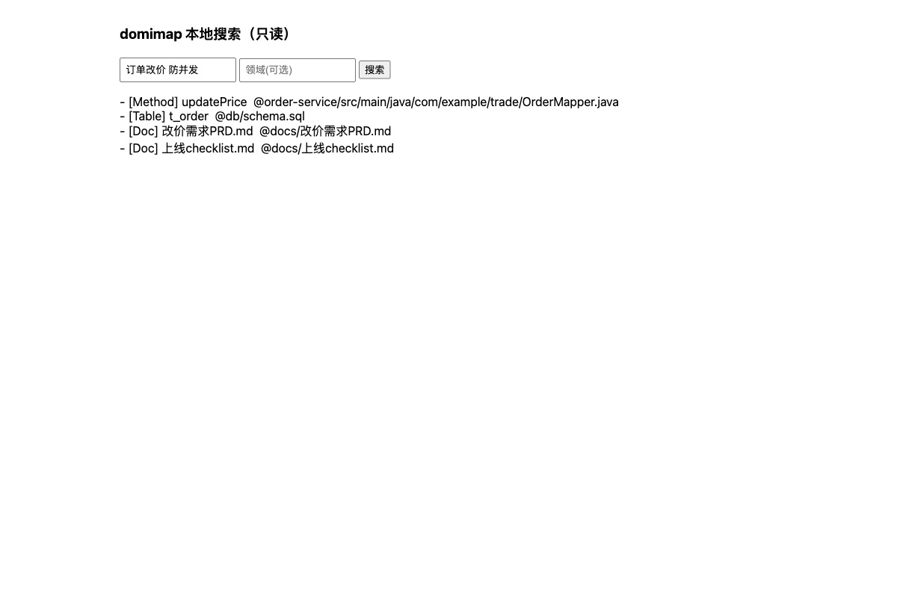
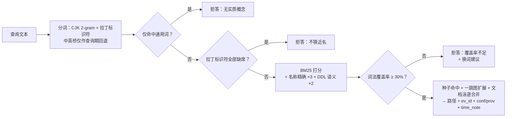

# domimap — 本地优先的知识检索引擎

**Domain + Map**：把多个 Java 仓库、项目文档和人工知识，变成一张可查询、带证据引用的领域地图。

[English](README.md) | **简体中文**

[](https://github.com/SunArthurX/domimap/actions/workflows/ci.yml) [](https://github.com/SunArthurX/domimap/blob/main/pyproject.toml) [](https://github.com/SunArthurX/domimap/blob/main/pyproject.toml) [](https://github.com/SunArthurX/domimap/blob/main/LICENSE)

## 什么是 domimap？

domimap 是一个本地优先的知识检索引擎，把多个 Java 仓库、项目文档和人工知识构建成一张可查询的领域地图。提供 CLI、MCP（Model Context Protocol）服务器和 Web UI 三种接口——让人和 AI Agent 都能在整个代码库中搜索、追踪并**引用证据**。建图过程是确定性的、**零模型调用**；大模型只以可选、明确标注的增强层出现。

## 核心能力

| 能力 | 说明 |
|---|---|
| **多仓聚合** | 多个仓库索引为一张统一图 |
| **混合检索** | BM25 词法 + 图扩展 + 领域种子（+ 可选本地嵌入） |
| **证据引用** | 每条结果带文件路径和不可变证据 ID |
| **不可变证据** | 源码修改/删除不破坏旧引用 |
| **知识时间线** | 内容纪元提取（显式日期/版本，非文件 mtime） |
| **诚实拒答** | 四道拒答门——不猜近名、不产出幻觉命中 |
| **MCP 集成** | 原生 MCP stdio 服务器（6 个 `kg_*` 工具） |
| **核心零依赖** | 纯 Python 标准库；可选依赖只做增强 |

## 快速开始

```bash
git clone https://github.com/SunArthurX/domimap.git && cd domimap

# 无需安装——纯标准库
# 单仓：--merge 让图直出 out/idx
python3 -m domimap build ~/my-java-projects -o out/idx --merge

# 多仓工作区（推荐）：自动发现子仓 → 合并图 + 证据库 + 增量清单
python3 -m domimap build ~/work/my-workspace --discover -o out/idx
python3 -m domimap update -o out/idx   # 增量更新；无变更毫秒级 no-op

# 或安装为命令行工具
pip install .            # 提供 `domimap` 命令

# 可选 PDF/DOCX 摄入
pip install pypdf python-docx
```

### 命令行

```bash
# 建图与增量
python3 -m domimap build ~/work/my-workspace --discover -o out/idx  # 多仓合并图 + 证据库
python3 -m domimap build ~/repo-a -o out/idx --merge                # 单仓
python3 -m domimap update -o out/idx                                # 增量

# 检索（中英文混合）
python3 -m domimap query "订单改价 changePrice" -g out/idx/graph.json
python3 -m domimap query "ai_resource 表 定义 写入" -g out/idx/graph.json

# 按证据 ID 读固化片段（源码改了仍读旧版本）
python3 -m domimap read <evidence_id> --store out/idx/store.db

# 领域地图 / 影响面 / 场景卡
python3 -m domimap domain -g out/idx/graph.json
python3 -m domimap impact "OrderService" -g out/idx/graph.json
python3 -m domimap scenario req "订单改价 需要防并发" -g out/idx/graph.json

# 机器可读图谱 schema（喂给你的 AI 客户端）
python3 -m domimap schema

# Web UI（仅回环监听）
python3 -m domimap ui -g out/idx/graph.json --port 8080
```

### 可选大模型增强（建图后置，默认关闭）

一条命令把图内 Doc 材料交给**可配置**的 LLM（anthropic 兼容协议，默认 GLM-5.3），产物一律作为**推断草稿——绝非事实**归档：

```bash
python3 -m domimap enrich -g out/idx/graph.json --limit 5            # docs（默认，增量）
python3 -m domimap enrich -g out/idx/graph.json --targets domain     # 按域聚合材料
python3 -m domimap enrich -g out/idx/graph.json --dry-run            # 预览，不联网
python3 -m domimap enrich -g out/idx/graph.json --json --budget-tokens 200000
```

- **配置**（flag > env > 默认）：`DOMIMAP_LLM_ENDPOINT`、`DOMIMAP_LLM_MODEL`（glm-5.3）、`DOMIMAP_LLM_MAX_TOKENS`（1024）、`DOMIMAP_LLM_TIMEOUT`（120s）；key 取 `GLM_API_KEY` / `ANTHROPIC_API_KEY` / `DOMIMAP_LLM_KEY_HELPER`（未配置或目录被锁 → 退出码 6，绝不静默降级）。
- **纪律**：草稿写入图旁 `knowledge.db`，标注 `conf=LLM, prov=knowledge:llm`、claims 一律 `inference/proposed`；人工 `accept` 后才算确认知识。`evidence_paths` 服务端白名单校验（编造路径剔除并记审计）。同图同模型重跑幂等（零调用零新笔记）；文档更新后旧 LLM 笔记自动软撤回；每次调用逐条落盘 `enrichment.jsonl`（中断安全、不重复计费）。
- **生产化**：4xx 当条失败不重试；429/5xx 尊重 `Retry-After` 指数退避；`--budget-tokens` 超限即停；同目录互斥（`.enrich.lock`）；材料以分隔符包裹并声明"是数据非指令"（提示注入缓解）；`--json` 输出逐篇明细与成本估算。
- **威胁模型**：key 只在进程内存使用；端点由你配置——数据会发往该端点；对抗性内容的最终闸门是人工审定。

### 查询期可选层（默认全关；离线核心语义不变）

- **语义桥**（`DOMIMAP_SEMANTIC_BRIDGE=1` 或 `query --semantic`）：原始查询覆盖率 <60% 且含中文时，由同一可配置 LLM 生成英文关键词，经索引词表**接地过滤**后并入候选并集重打分；任何失败干净跳过，拒答语义逐字不变。
- **LLM 重排**（`DOMIMAP_LLM_RERANK=1` 或 `query --rerank`）：对融合后 top-N 候选送 LLM 按查询相关性重排（只排列不透明 id——注入面为 0）。在我们语料上实测零收益；作为隔离的契约化选项保留。
- **嵌入融合**（`domimap embed` 建索引，查询 `--embed`/`DOMIMAP_EMBED=1`）：本地 **bge-small-zh-v1.5**（`pip install fastembed`，离线免费；`DOMIMAP_EMBED_BACKEND=api` 切 bigmodel embedding-3），查询期以 RRF(K=60) 融合词法序与语义序；**融合资格门**保证定义性标识符/代码定位类查询仍由词法通道权威。真实双集 A/B：pub 23/97→36/97、dev 19/36→26/36，零回归、负例不变。

## MCP 服务器

```bash
python3 -m domimap serve -g out/idx/graph.json
```

**Claude Code / ZCode / Codex / DSH** 接入（逐客户端注册方法见 [docs/clients.md](docs/clients.md)）：

```json
{
  "mcpServers": {
    "domimap": {
      "command": "python3",
      "args": ["-m", "domimap", "serve", "-g", "/path/to/out/idx/graph.json"]
    }
  }
}
```

| 工具 | 说明 |
|---|---|
| `kg_explore` | 主检索：词法种子 + 图扩展，返回服务/类/方法/路由/表/文档（带置信度与来源） |
| `kg_read` | 按证据 ID 读固化片段（不可变——源码变更后仍可读） |
| `kg_domain_map` | 领域地图：域 → 服务/表/主题/文档 |
| `kg_impact` | 影响面：符号的反向依赖 |
| `kg_doc_search` | 文档全文检索 |
| `kg_troubleshoot` | 问题排查：症状 → 图+文档双路召回 → 疑点排序 |

**Agent 推荐用法**：先 `kg_domain_map` 建立全景 → `kg_explore` 检索 → `kg_read(ev_id)` 读固化原文 → 回答引用**路径 + ev_id**；`refused=true` 时如实说明，不要编造。

### Web UI

```bash
python3 -m domimap ui -g out/idx/graph.json --port 8080   # 仅回环，零依赖
```



### 机器可读 schema

`domimap schema` 输出节点/边类型、置信度与来源语义、工具清单、拒答门的 JSON，契约测试保证与实现零漂移。人类可读参考：[docs/knowledge-graph.md](docs/knowledge-graph.md)。

## 架构

```mermaid
flowchart TB
    subgraph SRC["工作区：代码与文档"]
        REPOS["Java 仓库 · MyBatis XML · SQL DDL"]
        DOCS["Markdown · HTML · PDF* · DOCX* · TS/JS/Vue"]
    end
    subgraph BUILD["构建——确定性，零模型调用"]
        SCAN["扫描器（lite_scan）<br/>GBK/GB18030 自动识别"]
        CHUNK["长文档分段<br/>→ 重叠片段"]
        GRAPH["知识图谱<br/>12 类节点 · 13 种边<br/>置信度: EXTRACTED / INFERRED / AMBIGUOUS"]
        STORE["证据库（SQLite）<br/>ev_id · 内容寻址<br/>不可变 generation"]
        SCAN --> CHUNK --> GRAPH
        SCAN --> STORE
    end
    subgraph ENGINE["检索引擎（search.py）"]
        BM25["BM25 k=1.2 b=0.75<br/>标识符精确 ×3 · DDL 语义 ×2"]
        EMB["语义泳道（可选）<br/>本地嵌入 · RRF 融合<br/>+ 资格门"]
        EXPAND["图扩展<br/>CALLS · READS/WRITES · MQ 边"]
        LANE["文档泳道合并<br/>+ 内容纪元时间标注"]
        GUARD["4 道诚实拒答门"]
    end
    KBX["知识库（SQLite）<br/>人工笔记 · 主张 · 审定流程"]
    ENR["`domimap enrich`（可选后置）<br/>LLM 草稿笔记 · conf=LLM<br/>人工审定后才算事实"]
    CLI["CLI"]
    MCP["MCP stdio 服务器<br/>6 个 kg_* 工具"]
    UI["Web UI（仅回环）"]
    REPOS --> SCAN
    DOCS --> SCAN
    GRAPH --> BM25
    GRAPH -.可选.-> EMB
    STORE --> LANE
    KBX -.挂接.-> BM25
    ENR -.草稿.-> KBX
    BM25 --> EXPAND --> LANE --> GUARD
    EMB --> LANE
    GUARD --> CLI
    GUARD --> MCP
    GUARD --> UI
```

\* = 需要可选依赖（`pip install pypdf python-docx`）

### 查询数据流



进化与成熟度计划：[docs/evolution.md](docs/evolution.md) · 完整 schema 参考：[docs/knowledge-graph.md](docs/knowledge-graph.md)

## 基准测试结果

五个系统——domimap 与四个开源竞品（[Codebase-Memory-MCP](https://github.com/DeusData/codebase-memory-mcp)、[claude-obsidian](https://github.com/AgriciDaniel/claude-obsidian)、[Graphify](https://github.com/Graphify-Labs/graphify)、[CodeGraph](https://github.com/colbymchenry/codegraph)）——使用**同一宿主模型 GLM-5.3、同一系统提示、同一轮次/工具预算、同一语料的独立工作区副本**。评分为机械的答案层引用匹配（双向路径匹配）。以下数字均为**同会话开发者评测，不是 [specs/benchmark.md](specs/benchmark.md) 要求的冻结独立确认**，因此发布门禁 `make release-check` 仍处于关闭状态。

### 开发集——企业 Java 多仓语料（33 题）

27 道计分正例（代码定位 8 · 跨仓追踪 8 · 文档推理 5 · 知识时效 6）+ 4 道负例 + 2 道定位诊断。

| 系统 | 代码 | 跨仓 | 文档 | 时效 | **正例** | 负例（拒答） | 定位诊断 |
|---|---|---|---|---|---|---|---|
| **domimap** | **8/8** | **8/8** | **4/5** | **4/6** | **24/27 (89%)** | 4/4 | 2/2 |
| Codebase-Memory-MCP | 0/8 | 8/8 | 0/5 | 1/6 | 9/27 (33%) | 4/4 | 0/2 |
| CodeGraph | 3/8 | 0/8 | 0/5 | 0/6 | 3/27 (11%) | 4/4 | 0/2 |
| Graphify | 2/8 | 0/8 | 0/5 | 0/6 | 2/27 (7%) | 4/4 | 1/2 |
| claude-obsidian | 0/8 | 0/8 | 0/5 | 1/6 | 1/27 (4%) | 4/4 | 1/2 |

### 公开语料——27 个未暴露的开源项目族（40 题）

32 道计分正例（每类 8 道）+ 4 道负例 + 4 道定位诊断。

| 系统 | 代码 | 跨仓 | 文档 | 时效 | **正例** | 负例（拒答） | 定位诊断 |
|---|---|---|---|---|---|---|---|
| **domimap** | **6/8** | **8/8** | 4/8 | **4/8** | **22/32 (69%)** | 4/4 | 1/4 |
| Codebase-Memory-MCP | 5/8 | 8/8 | 3/8 | 1/8 | 17/32 (53%) | 4/4 | 2/4 |
| claude-obsidian | 5/8 | 3/8 | 4/8 | 1/8 | 13/32 (41%) | 4/4 | 3/4 |
| Graphify | 3/8 | 0/8 | **5/8** | 3/8 | 11/32 (34%) | 4/4 | 3/4 |
| CodeGraph | 2/8 | 3/8 | 0/8 | 0/8 | 5/32 (16%) | 4/4 | 0/4 |

公开语料配对差值（n = 36 = 32 正例 + 4 负例）：

| 对比 | domimap | 竞品 | 差值 |
|---|---|---|---|
| vs Codebase-Memory-MCP | 26/36 | 21/36 | +13.9 pp |
| vs claude-obsidian | 26/36 | 17/36 | +25.0 pp |
| vs Graphify | 26/36 | 15/36 | +30.6 pp |
| vs CodeGraph | 26/36 | 9/36 | +47.2 pp |

四组配对差值在两套语料上均为正，但在以英文为主的公开语料上差距明显收窄：Graphify 在文档推理类领先，定位诊断子集上有三个竞品高于 domimap。结论仅限于这两套语料与该宿主，不构成普适优越性声明。原始工件、运行器与冻结协议见 [`benchmarks/`](benchmarks/README.md)。

### 性能

| 指标 | 数值 |
|---|---|
| 建索引（9 仓 37K 文件） | 14 分钟 |
| 单次查询延迟 | < 1 秒 |
| 33 题全量评测 | 1.2 秒（诊断轨） |
| 内存（9 仓索引峰值 RSS） | ~4.3 GB |

## 支持格式

| 格式 | 状态 | 说明 |
|---|---|---|
| Java (.java) | ✅ 完整 | GBK/UTF-8 自动识别，注释入索引 |
| MyBatis XML (.xml) | ✅ 完整 | Mapper namespace、SQL 语句、表提取 |
| SQL DDL (.sql) | ✅ 完整 | CREATE TABLE 解析、DDL 语义加权 |
| Markdown (.md) | ✅ 完整 | front-matter（valid_until/superseded_by） |
| HTML (.html) | ✅ 完整 | 去标签、实体解码 |
| 纯文本 (.txt) | ✅ 完整 | GBK 回退 |
| PDF (.pdf) | ⚠️ 可选 | 需要 `pypdf` |
| DOCX (.docx) | ⚠️ 可选 | 需要 `python-docx` |
| TypeScript/JavaScript | ✅ 基础 | 前端框架识别 |
| Vue (.vue) | ✅ 基础 | 组件扫描 |

## 开发

```bash
make ci              # CI 同款：规格结构校验 + 全部测试
make verify          # 本地门禁：另校验 out/verification 证据指纹与工件哈希
make release-check   # 发布门禁——冻结确认跑完成前按设计保持失败
make mini            # 构建迷你测试图并试查询
```

PDF/DOCX 摄入契约需要可选解析器：`pip install pypdf python-docx`（缺失时自动跳过）。

### 项目结构

```
domimap/
├── domimap/           # 核心 Python 包（零依赖）
│   ├── lite_scan.py   # 多格式扫描器（Java/MyBatis/DDL/MQ/文档）
│   ├── chunking.py    # 长文档分段（BM25 + 嵌入双端）
│   ├── graph.py       # 知识图谱构建
│   ├── search.py      # BM25 + 图检索 + 拒答门
│   ├── embedding.py   # 可选本地嵌入索引（RRF 融合）
│   ├── llm_enrich.py  # 可选 LLM 草稿笔记（conf=LLM，人工审定）
│   ├── mcp.py         # MCP stdio 服务器（7 个只读工具含 kg_context；kg_feedback 须 --enable-write；热重载）
│   ├── store.py       # 证据库（不可变 generation）
│   ├── knowledge.py   # 知识库（笔记/主张/审定）
│   └── ...
├── benchmarks/        # 五系统比较套件 + 冻结协议
├── tests/             # 契约测试（每个特性都有负例）
├── specs/             # 需求、验收案例、任务清单
└── docs/              # 文档
```

## 文档

| 文档 | 说明 |
|---|---|
| [docs/README.md](docs/README.md) | 文档索引 |
| [docs/knowledge-graph.md](docs/knowledge-graph.md) | **图谱模型参考**——节点/边类型、证据库、时间模型、检索数据流 |
| [docs/evolution.md](docs/evolution.md) | **成熟度差距与进化计划** |
| [docs/roadmap.md](docs/roadmap.md) | 生产路线图 |
| [docs/architecture.md](docs/architecture.md) | 架构细节 |
| [docs/clients.md](docs/clients.md) | MCP 客户端接入指南 |
| [specs/benchmark.md](specs/benchmark.md) | 基准协议 |

## 已知限制

- **评测状态**：全部基准数字为同会话开发者评测；冻结独立确认未执行，`make release-check` 在此之前按设计保持失败
- **跨语差距（已大幅收窄）**：纯 BM25 无法把中文查询匹配到英文内容；可选嵌入泳道 + 文档分段把公开语料检索从 50→70/140——答案层复测仍在进行
- **同名方法**：不同类的同名方法共享一个节点（服务级命名取舍）
- **源更新**：增量更新需手动 `domimap update`（尚无文件监听）
- **平台**：macOS + Linux CI 完整测试；Windows 未测试

## 许可证

MIT License，见 [LICENSE](LICENSE)。
