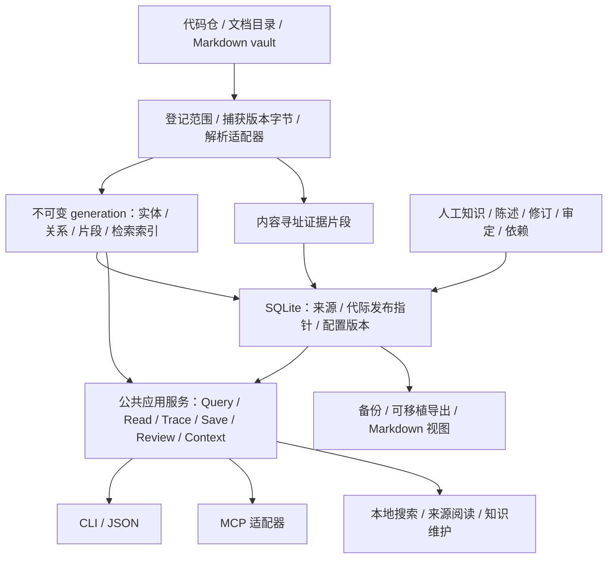

# domimap 生产架构与数据边界

2026-10-24 状态说明：下文保留目标架构，不能将旧的“尚未提供”描述当作当前源码清单。当前实现审计、已验证重构、兼容边界和剩余生产缺口见 [生产化重构审计](production-readiness.md)；规范性要求仍以 specs 为准。

2026-10-27 增补（漂移纠正二期 T0–T15，提交 ce3912d..9244bf8）：目标架构中的关键层已按规范落地——
① 所有 build 入口共用一条证据契约（`batch.build_many`：扫描单次读字节即固化，普通单仓 build 同样产出 store.db/不可变代/manifest）；② 显式来源身份（manifest 登记 label/root/service_prefix，节点 meta.sid，`EvidenceResolver` 按 sid 解析证据，`domimap rebind` 重绑物理路径而逻辑身份不变）；③ 派生产物（graph.json/coverage/manifest）原子发布并以内容哈希做增量与一致性校验；④ `domimap/workspace.py` 整库导出/恢复（逐文件 sha256 校验、失败不留半成品）；⑤ `domimap/service.py` `AppService` 是三入口（CLI/MCP/UI）唯一的装配与默认参数点（查询/文档检索/影响面预算/错误映射/热重载/as_of/可信上下文/知识写入口）；⑥ F3 可信上下文显式登记（`trust add`，嵌套 scope 裁决，MCP `kg_context` 桥接）；⑦ R06 原义复核闭环（发布后扫描依据变化→`review_pending`→检索面 stale→`recheck confirm` 绑定新证据）；⑧ `domimap/clients.py` 四客户端原生配置生成/幂等接入/受管撤销。各切片契约与证据见 specs/tasks/ 对应任务规格。

日期：2026-10-16。状态：**待实施设计**，随[生产主计划](roadmap.md)执行。下面的路径、模块、字段和工具均为目标契约，除明确注明外当前 v0.4.0 尚未提供。

## 1. 系统结构与责任



- 输入文件由用户持有，默认只读；不运行被索引项目的构建脚本、代码、宏或安装指令。
- 人工知识和审定为权威持久数据；机器图/全文索引是可重建派生数据。被固定的证据属于知识恢复必需内容，不能按缓存清理。
- SQLite 负责小粒度事务、关系约束、修订与发布指针。大型图文件仍可保留不可变格式；先按测量决定图存储/FTS5，不把数据库当语义引擎。
- CLI/MCP/UI 只适配展示/协议，调用同一应用服务；查询不自动写笔记或代替人工审定。模型生成在外部客户端或显式可选适配器，核心离线可用。

## 2. 用户目录与事实来源

建议用户数据根由显式 `--workspace`/配置选择，平台默认使用标准用户数据目录，不能落入安装包缓存。示意：

```text
<workspace>/
  domimap.json              # 工作区 ID、登记来源、策略、可信上下文
  state.sqlite3            # 权威元数据、人工知识/修订/审定、代际指针
  evidence/sha256/...       # 已固化证据，引用与保留规则管理
  generations/<id>/...     # 不可变派生图、分片、coverage、索引
  staging/<build-id>/...   # 未发布工作；不向读者暴露
  exports/...              # Markdown/Obsidian 派生视图，不重复摄入
  backups/...              # 明确保留策略；最好另有独立故障域副本
```

源码目录、源仓和知识数据根彼此独立。工作区可只登记文档目录。配置不携带客户端密钥；从一个路径重绑来源根不自动继承另一个仓的身份。默认拒绝索引产品状态/exports/backups 目录，显式导入走带来源语义的独立操作。

权威人工知识用 SQLite，普通 Markdown 提供可读导出与显式导入；现有用户 vault 先作为只读来源。编辑导出页不自动生效：导入检查 note_id/base_revision，展示冲突后提交。未来若做双向同步，必须补重命名/删页/并发策略，不能同时声称数据库和 Markdown 都自动拥有最终解释权。

## 3. 核心对象与不变量

| 对象 | 最小字段与约束 |
|---|---|
| Workspace / Repository / Module | 显式持久 UUID、来源根绑定、模块/服务边界；basename/绝对路径/分支名不是全局业务身份 |
| Source / SourceVersion | repo_id + 规范化相对路径；内容 SHA-256、字节/编码状态、可用 revision、采集时间/错误；无 Git 的 revision 为空 |
| Applicability | workspace、snapshot 必有；组件/ref/release/环境/生效时间按已知数据填写；unknown 不伪造，环境映射需登记 |
| Entity | repo/module/owner/signature 范围内的逻辑 ID、kind、source 与 locator；无法解析签名时 provisional 候选独立，不静默合并 |
| Relation | 两端 ID、类型、证据 IDs、规则与版本、解析/推断状态；不确定候选集合与未解析原因独立记录 |
| Evidence | source_version、locator、固化摘录与上下文、摘录哈希、解析器版本；在返回 ID 前可读；locator 坐标体系明确 |
| SourceFamily | 原始来源/派生关系、source_kind、draft/approved/unknown；不把副本或 AI 摘要数当独立支持数 |
| Knowledge / Claim | 稳定 ID、revision、正文、类型、范围、支持/反对证据、review_state 与 evidence_status；笔记包含多个可独立复核的 claim |
| ReviewEvent | 对象/关系/陈述修订、证据版本、适用范围、推导配置、决定、理由、时间与执行者；接受推断不改写抽取性质 |
| Context / TimePolicy | 可信文件的 scope/hash/budget；日期依据/as_of/timezone/有效期/衰减参数及版本，确定性参数可解释 |

补充约束：

1. 实体身份与内容版本分离；精确重复可以折叠展示，不能丢掉各自范围和归属。跨库同名表/Topic 默认隔离，共享靠显式映射。
2. 路径移动/符号重构无可靠对应时保留旧引用并提示重绑；别名不能自动继承旧审定。
3. 每次解析的哈希与片段来自同一份捕获字节。扫描过程中有变化就重试/标未收敛；多仓快照不暗示它们属于同一业务发布。
4. 位置采用声明的编码/行号/字符或字节坐标；MD 标题、PDF 页码、DOCX 段落等 locator 必须和展示内容一致。缺少位置不得虚构行号。
5. 内容变更、映射/解析规则或适用范围变化均可能令审定待复核；age、evidence_status、review_state 和支持类型各自独立。
6. 证据到期可以变 unavailable，仍保留引用身份及原因；被知识/审定固定者按保留政策存在。不能暗用当前内容替换。

在 M1 编码前补完整、可校验的 JSON 样例和版本迁移规则；此文不把字段清单当作 schema 已落地。

## 4. 发布一致性与多进程

一次构建的状态转换：capture → parse → validate → durable artifacts → commit publication。构建/发布只允许工作区内一个持有有效 lease/fencing token 的写者；读取可以并发。

1. 捕获源清单、字节和配置版本，写入唯一 staging；解析先注册实体再建关系，校验所有端点/证据/coverage。
2. 证据 blob 和不可变 generation 按唯一名写入，完成校验、必要的 flush/fsync 和目录发布。文件先持久化，不能只留在临时路径。
3. SQLite 短事务校验当前基代与 lease，登记完整 generation 并切换 active 指针，提交后读者才能使用。SQLite 不与文件系统天然构成一个事务，因此顺序不可颠倒。
4. 提交前崩溃：上一代仍是 active，新文件是可回收孤儿；提交后崩溃：新代的必要文件已经存在。启动校验失败显式回退上一完整代并诊断，不误报最新。
5. 一个请求固定 snapshot_id 和 knowledge_epoch；机器/人工缓存按这两个版本及配置键控，不将不同代的节点与边拼起来。新读者拿新指针，旧读者完成后释放引用。
6. 垃圾回收只删除非 active、非在读、非固定保留的代/证据，先验证引用，再回收；磁盘不足在发布前失败，已确认知识不可静默丢弃。

SQLite 建议采用 WAL、外键和 FULL 同步配置，并设置有界 busy_timeout/重试；M1 在目标平台验证，不以 WAL 名称证明可靠性。临时构建不持有长写事务，知识保存以短事务串行；锁失败返回可重试状态，不能无限等候。只支持本地可靠文件系统，网络盘/云同步直接共享 active DB 不在范围。

中断测试包括实际子进程退出与关键阶段故障注入；断电/硬件损坏的持久性依赖操作系统和文件系统，正式支持声明要区分过程崩溃、断电和备份恢复。

## 5. 查询与结果契约

目标公共服务：`query`、`read_evidence`、`trace`、`context`、`save_knowledge`、`review`、`export/restore`。保持现有 CLI/MCP 工具的可说明迁移路径；不一次暴露几十个重复工具。

QueryRequest 最少包含 query、workspace/snapshot、可选 applicability/filter、top_k、查询模式、as_of、输出/遍历预算。参数使用“显式请求 > 工作区配置 > 默认”；非法范围或数字直接拒绝，不依靠宿主自觉。

Result 最少包含：

- result_schema_version、snapshot_id、knowledge_epoch、resolved_scope、query_mode、as_of。
- 主候选和证据项：ID、定位、完整必要摘录、来源/日期依据、相关性解释、是否当前核验；扩展项单列。
- support_state（supported/partial/not_found/unchecked）、冲突陈述、unresolved、coverage_gaps。
- budget_status/partial_reason 与有界诊断信息；错误用稳定 code、是否可重试、可操作提示。

检索流程：资格与范围 → 按代码/文档/人工知识独立召回 → 精确重复/来源家族折叠 → 融合相关性 → 支撑与争议展示 → 时间策略 → 按完整项预算返回。人工层在 M3 接入；M2 不创造临时的第二套知识格式。

同内容不同适用范围不能因去重丢掉范围；机器图的领域节点只能导航。直接查询返回材料和有依据的结构，不宣称已经自动证明全部业务结论。

Read 只接受受管 evidence_id 与允许范围，禁止将任意客户端路径当文件读取 API。历史额外上下文未固化时明确不可用。按需对返回项做内容核验，不全盘哈希来换取每次查询的“新鲜”标签。

图遍历需在扩展前检查 nodes/edges/hops/time；按 CALLS、SQL、MQ、路由分别定义方向。避免将 MENTIONS、CONTAINS、BELONGS_TO 当作影响传播；多 provider/数据源未知保留候选。

时间策略沿用 F4 的候选：有明确生效/撤回/替代关系先处理；复核日期绑定版本，mtime 不独立提供新鲜度。年龄只影响时间敏感的合格资料，不能证明权威。候选 H=90 天、weight=0.2、日期未知因子 0.9 待试点校准。

## 6. 人工写入、恢复与互操作

- 单次提交包含 note/claims 修订、支持/反对依据、审定事件、依赖和幂等键，SQLite 事务内一致更新；知识检索索引在同事务更新，或响应明确 index_pending 并保证读取提交结果可查。
- 相同幂等键/相同 payload 返回同一结果；不同 payload 冲突。expected_revision 不匹配给出当前版本，不最后写入者覆盖。
- 源变更只标相关陈述 evidence changed；未重新核对不继承 last_verified_at。不把变更自动解释为结论错误，也不把人工接受当作业务已证实。
- 写入能力由用户明确启用/选择，服务端验证来源/知识库范围；明确保存指令直接提交，不添加每次重复确认。MCP 的工具描述或上下文不能替代服务端权限和约束。
- 导出包括知识/陈述/修订/审定、范围、来源映射与被固定证据及格式版本/哈希；不默认包括凭证或全业务源码。恢复先在新目录校验再切换，不覆盖已有知识。
- 导入/恢复校验清单、schema、内容哈希和资源限额；归档路径规范化后必须留在新目录，禁止通过绝对路径、父目录或符号链接越界，不执行其中脚本。
- 在线备份使用数据库支持的备份机制，并固定必要 blob 集合；不能只复制运行中的 sqlite 主文件遗漏 WAL。备份清单、完整性和干净恢复一起验收。
- MD 导出使用 frontmatter 保存稳定 ID/base_revision，链接可指向其他笔记及证据；导入不信任其中权限/上下文设置，按冲突策略提交，避免知识被再次当成独立原始证据。
- 保留策略区分临时查询证据、被固定证据、旧 generation、历史修订、备份。主动删除/遗忘需说明这些对象的清理效果及例外；无法控制外部 Agent 历史。

## 7. 信任边界与资源防护

| 边界 | 必须实现与验证的行为 |
|---|---|
| 本地来源 | 规范化/realpath 允许根，文件符号链接/路径穿越受控；检查读取目标一致性，忽略输出/密钥/显式排除目录，失败进入 coverage |
| 资料与指令 | 检索资料是数据；AGENTS/SOUL 只由显式可信路径按任务作用域加载；不越过宿主权限与更高优先级指令 |
| 上下文 | 哈希独立更新；按完整段落预算，缺失/超限可诊断；客户端原生桥接与 kg_context 避免重复注入，不能保证宿主必然服从 |
| 解析器/插件 | 固定来源/版本，进程/内存/时间/字节限额；坏 PDF、压缩炸弹、异常编码/超大输出不得拖垮主查询；不运行源项目脚本 |
| MCP | 使用协商/声明支持的协议；检查请求对象类型、schema、长度/范围、通知/未知方法/取消；stdout 仅协议，stderr 诊断，不将底层堆栈/秘密返回客户端 |
| 本地页面 | 回环地址、Host/Origin 校验、会话能力令牌/CSRF 防护；限制跨域；文档/Markdown/HTML/SVG 安全呈现，路径只按受管 ID 访问 |
| 外部网络 | 核心默认无出站；客户端模型可能收到返回片段，使用说明明确这一点；可选模型/来源连接器说明发送内容和开关 |
| 写操作 | read-only 与可写能力分离；稳定目标 ID/expected_revision/幂等键，模板和说明不能扩大权限 |
| 运行数据 | 日志默认不含正文/完整查询/密钥；诊断导出可预览净化；权限继承本机用户，不声称防御已控制该系统账户的攻击者 |

核心预算包括扫描文件数/单文件大小、解析时间、查询长度、top_k、遍历规模、返回字节、并发/队列、快照磁盘配额。超限有稳定状态与覆盖缺口，不静默“成功完成”。

## 8. 兼容、迁移与可观测性

产品版本、数据库 schema、图 schema、结果 schema、解析器与推断规则版本分别记录。不支持的新 schema 拒绝误读；旧机器图可重建，人工知识迁移必须先备份、事务更新、失败保留可恢复版本。旧程序不强行打开新数据库；回退通过保留的备份或兼容读路径。

MCP 使用[官方 Python SDK](https://github.com/modelcontextprotocol/python-sdk)的固定已测版本；协议随真实客户端能力选择，参照[官方版本规范](https://modelcontextprotocol.io/specification/latest/basic/lifecycle)。本轮 latest 已指向 2026-07-28，不代表现有客户端/SDK支持；旧服务固定回 2024-11-05 也不能作为所有客户端协商正确的证据。输入/输出契约与 SDK 升级分别测试。

结构化诊断至少包含 request/build ID、版本、状态/耗时、候选/展开计数、snapshot/knowledge epoch、解析缺口与缓存/队列状态；UI 只呈现用户能处理的信息。doctor 不主动导入未经选定的重型后端，也不把“模块存在”当联调通过。

查询观测（retrieval-observation，R06）：CLI/MCP/UI 三入口经同一 `observation.run_query` 包装记录每次查询到工作区独立 `queries.db`（与权威证据/知识库分库；schema `domimap.obs.v1`）。事件含执行状态（ok/refused/error/cancelled）、结构化拒答原因码（与 search.py 拒答分支一一对应，消费方不得从中文文案反推）、实际生效参数、有序候选、版本指纹与耗时。记录 fail-open：任何记录异常返回 `recording_failed`，查询结果/排序/exit code 不变。隐私默认不存查询原文（HMAC-SHA256 工作区密钥摘要支持本地归并；`DOMIMAP_KEEP_QUERIES=1` 显式保留原文，`DOMIMAP_OBSERVE=0` 整体关闭）。幂等键同内容去重、异内容记冲突不覆盖；容量固定上限最旧先出；重试/回放事件以 parent/trigger 关联原始请求，不并入真实用户请求数。

查询反馈（retrieval-feedback，R06，drift 纠正后）：同库 feedback 表承载 hit/partial/miss/not_applicable 相关性与任务结果判定；幂等摘要覆盖完整规范化 payload（含理由/期望证据），同键异内容记冲突；同来源修订须携带 expected_revision（乐观并发），不同来源为并行意见，权威矛盾进 disputed。有效相关性只由权威来源最新修订决定；人工样本选用时间只看权威来源（AI 建议不改变采哪条人工判定）；统计分母只用用户 profile（replay/诊断事件不污染 unknown/覆盖率），分来源命中率单列，correct_refusal 明示为 refusal-precision。恢复为先校验后触碰（完整 schema/完整性/关联断链校验、占用拒绝、安全副本、失败不损原库）；删除同步清理派生（诊断原文/簇关联/孤儿簇），改进固定证据拒绝删除；容量裁剪豁免已判定事件。

诊断（retrieval-diagnosis，R06）：miss/失败/异常的用户事件按查询摘要归并问题簇（正确拒答与争议不入队）；规则预检先行——期望证据解析、诊断性重跑（top_k=50 确定性核心，trigger=diagnostic + parent 关联，不污染用户统计）区分排序/召回/呈现/范围问题；无依据处进 unknowns 不武断。诊断包（domimap.diag.v1）可导出给 coding agent；可选模型分析每簇一次、同输入复用、失败冷却、输入输出上限、白名单字段解析、查询与资料在提示中一律是数据非指令；无模型时规则诊断与人工导出照常。诊断不改检索代码、不写知识库；改进走独立任务与回放。

受控进化（retrieval-evolution-pilot/replay，R06，drift 纠正后）：回放期望绑定精确节点身份（expect= node/nodes；同文件错误节点=miss；旧名称/路径子串格式拒绝）；run 带冻结 manifest（runner/scorer/样本摘要/图与知识代际/词表指纹/代码指纹），冻结维度不一致不可比较，缺 manifest 的旧 run 仅作历史；可选层显式关闭（semantic/rerank/embed=False）。activated 门槛：现存簇+属于该簇的诊断+三 run manifest 一致+improved 判定+回滚逐样本等价且代码指纹相同+候选指纹非 unknown；追溯链只显示关联 run。诊断侧：簇键含范围与版本、partial 入队、再裁决移出、当前重测与历史复现分离（版本不一致降为假设）、召回池成员资格实证。首次真实闭环已在精确评分与独立裁决的冻结样本集上重证（2026-10-26：目标名次 15→4 与 5→1、零回归、回滚等价、新启用 imp:d914a167c7a25b8401fe；旧 imp:ccf1ee268b695abbf2cd 因 F02/F03/F04 失效留档）。


支持矩阵以实际 OS/Python/extras/客户端/格式构造为单位。核心和可选依赖分别安装测试；build 环境依赖固定，库依赖声明兼容范围并记录实际 release 解析结果。卸载移除产品和受管客户端配置，不自动删除用户知识。

## 9. 后续团队部署的变化点

如果首批使用证明需要团队服务，复用应用契约和来源/知识模型，新增用户/租户与源级/知识级 ACL、服务认证、访问审计、并发容量、集中备份/密钥、网络安全和部署 SLO。不能把 source scope 当访问权限，也不能直接复制本机数据库到共享盘来实现团队一致性。

本轮未实现或实测该团队方案；不将其作为本地首发的隐含承诺。具体实施与验收统一回到主计划需求 ID。
