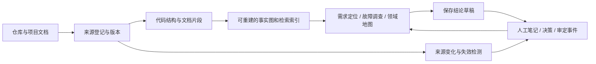

# domimap 方向复核与调整依据

> 首轮分析记录。随后完成了[十轮递进复核](2026-10-16-ten-rounds/review-log.md)及生产准备度复核。当前实施顺序统一以[生产级知识库主计划](../../../roadmap.md)为准；[第三版路线](../plans/2026-10-16-v0.5-v0.8-知识库演进路线.md)和下文保留演进背景。

日期：2026-10-16。基线：本地 v0.4.0 源码、现有计划、夹具测试，以及下列四个上游项目的官方仓库。本次交付是方向评审与计划调整；以下新能力均为待实施。

## 1. 决策

**需要调整优先级和产品边界，保留现有 Java 多仓底座。**

建议定位：**面向 Java 研发团队、连接代码与项目文档、能沉淀和复用人工结论的本地知识库。** 第一批用户以维护多个服务的开发者、技术负责人为主；用“需求定位、故障调查、领域理解”验证价值，再逐步扩展语料与语言。

这个定位沿用现有 README 的 Java、多仓、本地与 MCP 基线。用户本轮没有指定通用个人笔记产品、云服务或多人在线协作，因此这些方向不作为当前阶段的投入前提。

主要调整：

1. 把“图中事实能否区分、定位、更新”放到扩大扫描能力之前。
2. 把“查到证据 → 保存结论 → 人工修订 → 下次复用 → 源变更后提示失效”列为知识库的核心闭环。
3. 保留 Spring/MyBatis/Dubbo/MQ/JPA 等规则资产；通过适配层评测代码解析引擎，不预定整体切换 Graphify。
4. 用严格分开的质量指标替换混合命中口径；用真实任务证明价值后，再决定数据库、监听器、语义模型等投入。

## 2. 四个项目各取什么

同名项目较多，本次明确采用以下仓库作为比较对象。上游默认分支会变化，下面是核查日观察；正式接入时仍需固定版本。

| 参考项目 | 官方资料中可核实的特点 | domimap 应吸收的设计 | 当前状态 |
|---|---|---|---|
| [AgriciDaniel/claude-obsidian](https://github.com/AgriciDaniel/claude-obsidian) | 普通 Markdown 知识库、来源与主张记录、可恢复的写入事务 | 来源保留、结论生命周期、冲突检查、可恢复保存 | 当前只有待审 Markdown 导出，尚无审定结果导入与保存事务 |
| [DeusData/codebase-memory-mcp](https://github.com/DeusData/codebase-memory-mcp) | 持久代码图、AST 与 Java 类型解析、MCP 消费 | 符号身份、结构查询、版本化索引、解析能力边界 | 当前正则抽取与 JSON 图是有效原型，尚非精确代码语义引擎 |
| [colbymchenry/codegraph](https://github.com/colbymchenry/codegraph) | explore 返回相关原始源码，监听变化，并提示待更新文件 | 预算内返回可阅读的证据，明确数据新鲜度 | 当前仅图文件热重载；源码改变不会自动触发更新，返回路径也不等于返回源码 |
| [Graphify-Labs/graphify](https://github.com/Graphify-Labs/graphify) | 代码与异构资料统一成图，关系带置信，支持多种导出 | 统一证据模型、可解释连接、可移植导出 | 当前文档是整篇文本节点，代码与文档主要靠词面连线 |

claude-obsidian 的事务细节见[官方事务契约](https://github.com/AgriciDaniel/claude-obsidian/blob/main/skills/wiki/references/operation-transactions.md)。Graphify 的抽取接口、验证与置信定义见[官方架构文档](https://github.com/Graphify-Labs/graphify/blob/v8/ARCHITECTURE.md)。这些是产品设计参考，不是 domimap 已经获得的能力。

综合四者的价值在于贯通上述环节。没有必要同时复制四套工具、把它们的全部 MCP 面都暴露给用户，或自行维护通用语言解析器。

## 3. 已有投入的价值与实际成熟度

值得保留的资产：

- Java 业务框架规则与小型回归夹具，覆盖路由、SQL、RPC、MQ、JPA、前后端关联。
- 多仓发现、图合并、中文标识符检索、领域种子、CLI 和 MCP 入口。
- 置信标签、规则来源与覆盖缺口的初步表达。
- 本地可运行的打包结构，以及无需托管服务的部署方式。

本次执行 `python3 -m unittest discover -s tests -v`，**22/22 通过**；`doctor` 正常。这说明已有夹具契约可以运行，不能据此认定真实知识库效果或大规模增量正确性已经验收。

没有重扫任何真实业务工作区。历史的“45 仓、33 秒、约 16 万节点”在当前目录缺少可复核的完整测量记录，本次保留为历史报告，不据此推导正确率、跨平台兼容或线上性能。

## 4. 影响路线选择的具体问题

诊断只使用项目夹具和临时合成仓库，结果保存在 [baseline-audit.json](2026-10-16-baseline-audit.json)。其中 `checks` 各键对应下表实验；当前产品代码未修复这些问题。

| 优先级 | 发现与证据 | 实际影响 | 下一步 |
|---|---|---|---|
| P0 | `graph.py:70` 方法 ID 只有 service + 方法名。夹具 Controller 与 Service 的 `changePrice` 合成一个节点 | 调用链压缩、来源错配、影响面失真 | 先修身份与归属；无法解析的签名不得强行合并 |
| P0 | `graph.py:66,158` 类无仓库命名空间，文档只有相对路径。两个合成仓的同名类各剩 1 个，两个 README 各剩 1 个 | 多仓结果可发生静默覆盖 | 建 repo/source 身份及冲突检测；重新构建派生图 |
| P0 | `tests/test_replay.py:48` 把原始 Top-5 与场景卡字符串命中相加；场景卡默认 `top=10` | 原“100%”不能解释为严格 Top-5 | 沿用现有期望串、去掉兜底后，原始 Top-5 为 **6/8=75%**；混合口径为 **8/8**，仍需建立 ID 级验收 |
| P0 | `graph.py:94` 先连 SQL→表，之后才补无 DDL 的表节点。移除夹具 DDL 后：2 个 SQL、表存在、读写边为 0 | 常见的仅 Mapper 仓库无法追到表 | 改为先注册节点再解析关系，并做顺序不变性验证 |
| P0 | `batch.py:90` dirty 保存仓库 label，预扫描收到相对 label，合并却按实际 root 取缓存；其后重新扫描所有仓 | 一个仓变化，另一个标为 no-op 的仓仍被扫描 | 修 root/label 混用并持久化每仓记录；不把无变化路径等同完整增量 |
| P0 | `batch.py:43` 未将领域配置纳入指纹。替换 seeds 返回值而源码不变，仍全 no-op | 词表改了，领域地图可能不更新 | 对配置、规则版本和输出完整性做失效校验 |
| P0 | `mcp.py:10` 的 `kg_explore.required` 放在 inputSchema 外；`_fresh` 仅检查图文件 | 入参契约和源码新鲜度没有完整保障 | 修 schema，返回快照时间和覆盖状态；补真实客户端契约测试 |
| P1 | `__main__.py:104` 只导出勾选页，未实现导入、审定事件或恢复 | 人审结果不能稳定进入下一次查询，无法形成知识积累 | 新增人工知识层与审定覆盖层 |

另有源码检查发现、尚未做独立量化实验的风险：

- `lite_scan.py:175` 用声明后的 3000 字符当方法体，会跨越方法边界；接收者按类名小驼峰推断，未按实际字段类型解析。不能把这些 CALLS 当作完整或精确调用链。
- `graph.py:81,117,140` 路由、主题与页面标识缺少服务、消息集群或源文件范围；同名表也缺少数据源范围。共享业务实体必须显式对齐，不能靠名字直接全局合并。
- `graph.py:125` 按接口短名和 provider 类名对齐 RPC，多 provider 时覆盖；前端连线没有实际执行注释所称的 HTTP method 兼容判断。
- `search.py:157` 在文本末尾直接截断预算，可能切掉出处；`_render` 没有渲染存储的方法行号和原始方法体。当前“Read 等价”的说法应收窄。
- `mcp.py` 的文档工具先在全图取 Top-8 再筛 Doc；`scenario_trb` 也复用同一次全图排名。它们尚不是独立文档与代码召回后再融合的检索器。
- manifest 在新图发布前写入，缺少多产物一致性保护；构建期间源文件改变、缓存损坏、源删除与输出丢失的恢复契约也未覆盖。
- 大文件、读取错误、部分不支持类型未全部进入 coverage，截断也缺少明确标记；“没搜到”不等于“没有”。

因此，当前合适的成熟度描述是：**能够演示三种场景的本地原型，有可保留的规则资产，需要补可信数据与知识管理契约。**

## 5. 建议的架构边界

两个数据层必须分开：

- **机器派生层**：源码事实、片段、推断边、搜索索引。可删除重建；记录扫描范围和生成版本。
- **人工知识层**：架构决策、业务解释、已确认故障结论、领域纠正。持久保存，引用版本化证据；重建不得覆盖。

最小数据契约：

| 对象 | 必要字段或约束 |
|---|---|
| Repository / Source | 显式稳定的 repo_id、相对路径、来源 URI、内容哈希、revision（无 Git 则为空）、采集时间 |
| Entity | repo + module + 文件 + owner + 符号签名；路径与显示名不是全局身份 |
| Evidence | source_id、源哈希、代码行区间或文档标题/页码/片段位置、摘录、抽取器与版本 |
| Relation | 两端 ID、类型、证据引用、生成规则、抽取或推断置信；不能定位的关系明确降级 |
| Knowledge / Claim | 正文、关联实体、证据引用、作者/修订、草稿或审定状态、失效与冲突状态 |
| ReviewEvent | 审定对象与证据哈希、决定、理由、时间；原始机器推断保持可追溯 |

“人工接受”与 `EXTRACTED` 是两条轴：人认可推断，也不能把它改写成“源码明确声明”。同理，文件里明确写了一句话，不代表该句话在现实中已经验证为真。来源新鲜度也不应混入这两类状态。

领域名称仍可使用中文；允许多候选、未知、冲突与人工纠正，保留词表命中依据。先让领域结果可校正，再评估社区发现是否改善真实指标。

## 6. 技术取舍

| 选择 | 调整后的决策与触发条件 |
|---|---|
| 纯 Python stdlib | 保留核心的低门槛；允许解析器、文档、模型作为明确的可选适配器。缺失时报告降级，不模拟能力 |
| 正则 → AST | 先修身份契约；对 Codebase-Memory-MCP、CodeGraph、Graphify 与直接 Java AST 方案做同集评测，只接一个通过门槛的后端 |
| JSON → SQLite/FTS5 | 先保留兼容输出；冷启动、内存或写入一致性成为实测瓶颈时迁移。FTS5 要做可用性检测并保留中文分词策略 |
| 文档语义与向量 | v0.6 先做片段、关键词、别名与显式引用；若固定同义表达集仍不能过线，再比较向量或模型方案 |
| 自动监听 | v0.5 先做到手动 update 正确和显式 stale；v0.7 再做文件增量、监听与溢出后的重扫恢复 |
| 可视化 | 优先证据列表、来源阅读、领域页与审定操作；有明确关系探索需求后再加全图视图 |
| SkyWalking / 云协作 | 当前只列条件 backlog；有可用 trace 数据或明确的多人使用需求时再启动 |

这些取舍来自当前瓶颈与投入顺序，而非否定后续能力。上游也在继续覆盖 Java 和跨仓场景，差异化需要由自己的任务集证明，不能沿用“四家都没有”的历史结论。

## 7. 验收改为四条独立证据链

以下是未来目标，尚未完成：

1. **结构正确性**：标识碰撞、误连边、源位置、删改与全量/增量等价的回归；固定构建版本下，规范化节点与边集合应完全一致。
2. **任务质量**：至少 20 个历史需求、10 个故障调查、20 个困难负例；领域标注抽样最多 100 个服务，小于 100 则全量并报告样本量。训练与验收集分开，不通过修改期望维持绿灯。
3. **知识复用**：在新会话里能再次找回已审定结论；源变更会提示失效；重建不会丢掉笔记或审定记录。
4. **使用成本**：比较相同任务与预算下的关键词/读文件、仅文本检索、图加文本三条路径；同时报告正确率、工具调用、返回字数与延迟，不挪用上游性能宣传。

检索层 `query Top-5`、场景层 `scenario Top-5`、人工终审的任务成功率分别计算。命中按事先标注的实体/证据 ID 判断，不靠整张卡是否出现某个子串。故障调查的代码关系用于提出调查方向；没有运行时证据时不承诺确定根因。

## 8. 历史材料的使用方式

原《文档详细分析与命名》包含“150 遍分析”“951,364 条信号”“四家共识”等判断，当前目录没有配套完整原始材料。本次不验证其审计结论，也不把它们作为架构决策的必要前提。

原 v0.4 计划保留为实施历史；后续又完成第三版路线与生产准备度复核。下一步统一以[生产级知识库主计划](../../../roadmap.md)为准，开源准备从 M0 开始。
